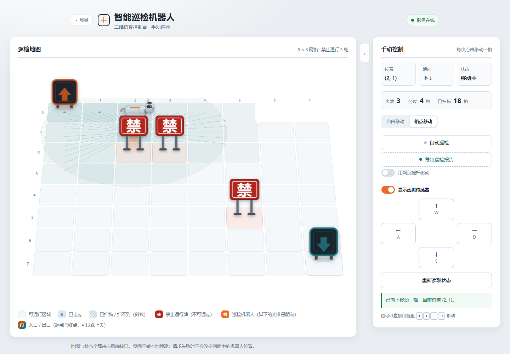

# 基于 Web 的智能巡检机器人二维仿真系统

本项目是 广东海洋大学阳江校区人工智能协会 培训班的结课作品。我们将机器人的巡检场景搬到浏览器中，通过二维地图展示机器人如何移动，以及它的位置、朝向和运行状态如何随操作变化。

## 两张地图

开场弹窗里可以选地图：

- **标准巡检区** 8×8，3 处「禁止通行」牌——默认图，与接口契约一致；
- **仓储通道** 10×8，7 处障碍——用来验证非正方形地图与更密的障碍。

## 两台机体

开场弹窗里的第二栏选机器人，两台机体的碰撞半径和速度不一样：

| 机体 | 半径 | 速度 | 手感 |
| --- | --- | --- | --- |
| 机器狗 · Go2-lite | 0.26 格 | 2.6 格/秒 | 钻得进窄缝，转弯灵活 |
| 轮式巡检车 · Rover-1 | 0.34 格 | 3.2 格/秒 | 直线更快，贴边和过缝要留余量 |

半径参与避障判定（圆对正方形障碍的连续扫掠），速度决定自由模式下的移动快慢；两者都由
`GET /api/robots` 与前端 `ROBOTS` 目录共同维护，改一边要同步另一边。

切换地图会把机器人放回该图起点，步数与巡检痕迹一起清零。巡检报告除了导出 Markdown，还会存一份到服务端（`GET /api/reports` 可查最近 50 条）。

## 轨迹与巡检记录

- **行走轨迹**：每帧采样机器人位置，在地面上连成一条铜橙色虚线；右栏「显示行走轨迹」可关掉，偏好记在本地；
- **巡检报告**：一轮自动巡检走完后点「导出巡检报告」，Markdown 里除了统计，还带一张字符画路线图（`#` 禁止通行、`o` 走过、`.` 可通行、`@` 当前位置）和按格子去重后的坐标序列；
- **巡检记录**：点「查看巡检记录」弹出列表，数据来自 `GET /api/reports`，按时间倒序显示时间、地图、点位、用时、步数、覆盖，最多最近 20 条。

## 虚拟传感器

右栏「显示虚拟传感器」开关（默认开）：机器人周围 2.6 格内打 56 条射线，碰到「禁止通行」牌或边界就停，射线画成扫描线、范围画成虚线圆；扫过的格子在图上留一层淡青色底、被牌子挡住的画浅斜纹（盲区），面板上同步显示「已扫描 n 格」。这是纯前端模拟，用来把「覆盖了多少」可视化，不涉及后端接口。地图本身由后端 `SCENES` 提供（`GET /api/scenes` / `POST /api/scene`），前端按 `grid.width/height` 渲染，加一张图只需要改后端。

## 在线演示

本项目未部署到公网，在本地跑起来即可演示：

```bash
./start.sh      # Linux / macOS / WSL
start.bat       # Windows
```

启动后在浏览器打开 <http://localhost:8080/>（端口被占用时脚本会自动顺延并打印实际地址）。页面先弹开场选择，选好地图与机器人点「开始巡检」进入：可以用方向键、WASD、网页摇杆或直接点地图移动，右侧面板实时显示坐标、朝向与运行状态；点「自动巡检」会自己规划顺序（每步挑走得最近、还没巡过的点位）走完整张地图，随时点地图或按方向键即可接管；走完可一键导出 Markdown 巡检报告。

演示的是二维仿真，不是真机；地图与障碍物来自后端接口，页面不做本地预测。



## 技术选型

- 前端使用 `原生 HTML + CSS + JavaScript（无框架）` 开发页面和操作界面。
- 后端使用 `Python 3.10+ + FastAPI + Uvicorn` 提供 API（CI 在 3.14 上验证）。
- 二维地图和机器人使用 `DOM 元素 + CSS Grid` 绘制。
- 仿真逻辑使用 `纯 Python` 实现，代码位于 `backend/app/sim.py`，不依赖第三方仿真库。
- CI 使用 `GitHub Actions` 运行自动检查（ruff 风格检查、compileall 语法检查、pytest 单元测试）。
- Docker 部署使用 `Dockerfile` + `.dockerignore`，容器以非 root 用户运行，一个容器同时提供页面与 API（步骤见[运行说明](docs/04_运行与结业提交.md)）。

## 项目文档

- 了解功能范围和验收方式，见[项目需求](docs/01_项目需求.md)。
- 查看模块职责和数据流向，见[项目架构与接口](docs/03_项目架构与接口.md)。
- 本地启动与 Docker 部署步骤，见[运行说明](docs/04_运行与结业提交.md)。
- 查看团队成员及各自完成的内容，见[小组分工](docs/02_小组分工.md)。
