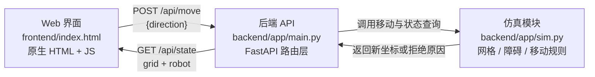

# 项目架构与接口

本文档描述基础版（二维仿真巡检机器人）的实际实现：Web 界面、后端 API 与仿真逻辑如何配合，控制指令和状态数据如何传递。

技术栈：Python 3.14 + FastAPI + Uvicorn + 原生 HTML/CSS/JavaScript（无外部 CDN 依赖）。

## 架构图



> 前端由后端在根路径 `/` 直接托管（`StaticFiles`），因此页面与 API 同源，浏览器不存在跨域问题，Docker 里单个容器即可同时提供页面和接口。

| 模块 | 实际职责 | 代码目录或入口 |
| --- | --- | --- |
| Web 界面 | 绘制二维网格与障碍物、绘制机器人、提供方向按钮、发送移动请求、根据返回状态重绘 | `frontend/index.html`（及相关静态资源） |
| 后端 API | 路由装配、请求校验、统一错误格式、`PORT` 环境变量校验、静态文件挂载、访问日志 | `backend/app/main.py`，入口 `app/main.py:create_app()` |
| 仿真逻辑 | 维护 8×8 网格、障碍物集合与机器人状态；判断移动是否越界或撞障碍；移动成功后更新坐标与朝向 | `backend/app/sim.py`（当前为 `main.py` 内的占位实现，由 A 替换，接口字段不变） |

## 数据约定

- **地图坐标原点、坐标方向和单位**：原点 `(0, 0)` 位于**左上角**；`x` 轴向右递增，`y` 轴向下递增；单位为「格」，一格即一个可站立位置。
- **地图、边界和障碍物的表示方式**：网格为 `grid.width × grid.height`（基础版 `8 × 8`），坐标为整数，合法范围 `0 ≤ x ≤ 7`、`0 ≤ y ≤ 7`；障碍物以坐标数组列表给出，元素形如 `[x, y]`，机器人不可进入障碍格，也不可越出网格边界。
- **机器人位置、朝向和运行状态字段含义**：
  - `x`、`y`：机器人当前所在格子的整数坐标；
  - `heading`：当前朝向，取值 `up` / `down` / `left` / `right`（与最近一次成功移动方向一致，初始为 `up`）；
  - `status`：运行状态，`idle` 表示静止待命，`moving` 表示刚完成一次移动。
- **前端获取最新状态的时机和方式**：页面首次加载时调用一次 `GET /api/state` 完成初始化；每次点击方向按钮后调用 `POST /api/move`，**直接使用该响应中的完整状态重绘**，无需再单独查询一次；请求失败（4xx/5xx）时按错误码在页面上提示，并保持当前画面不变。

## 接口约定

基础版仅需三个接口，均为 JSON 格式。填写的请求与响应字段与 `backend/app/main.py` 及 `backend/tests/test_smoke.py` 中的断言完全一致。

| 用途 | 方法与路径 | 请求参数或请求体示例 | 成功响应示例 | 失败响应示例 |
| --- | --- | --- | --- | --- |
| 健康检查 | `GET /api/health` | 无 | `{"status":"ok"}` | 一般不失败；服务未启动时连接被拒绝 |
| 获取地图与机器人状态（获取地图 / 获取机器人状态合并为一个状态接口） | `GET /api/state` | 无 | `{"grid":{"width":8,"height":8,"obstacles":[[2,2],[3,2],[5,5]]},"robot":{"x":0,"y":0,"heading":"up","status":"idle"}}` | `500` `{"error":{"code":"internal_error","message":"服务器内部错误"}}` |
| 发送手动控制指令 | `POST /api/move` | `Content-Type: application/json`<br>`{"direction":"right"}`<br>取值只能是 `up` / `down` / `left` / `right` | 返回移动后的完整状态，例如向右走一步：<br>`{"grid":{...},"robot":{"x":1,"y":0,"heading":"right","status":"moving"}}` | 越界：`409` `{"error":{"code":"out_of_bounds","message":"已到地图边界，无法继续移动"}}`<br>撞障碍：`409` `{"error":{"code":"blocked","message":"目标格是障碍物，无法通过"}}`<br>方向非法：`400` `{"error":{"code":"invalid_direction","message":"direction 只能是 up、down、left、right"}}`<br>请求体非 JSON：`400` `{"error":{"code":"invalid_json","message":"请求体必须是合法的 JSON"}}` |

### 统一错误格式

所有错误响应体结构固定，前端只需按 `error.code` 分支处理，无需解析自然语言：

```json
{"error": {"code": "错误标识", "message": "给人看的说明"}}
```

| HTTP 状态码 | `error.code` | 触发场景 |
| --- | --- | --- |
| 400 | `invalid_json` | 请求体不是合法 JSON |
| 400 | `invalid_direction` | `direction` 缺失或不在 `up/down/left/right` 之内 |
| 409 | `out_of_bounds` | 移动后坐标超出网格边界 |
| 409 | `blocked` | 目标格为障碍物 |
| 404 | — | 访问未定义的路径（由静态文件处理器兜底返回） |
| 500 | `internal_error` | 未捕获的服务端异常，同时写入服务端日志 |

### 运行时配置

| 环境变量 | 默认值 | 说明 |
| --- | --- | --- |
| `PORT` | `8080` | 服务监听端口。非整数或超出 `1-65535` 时启动即报错退出，并输出可读原因（而不是抛异常栈） |

启动方式：

```bash
cd backend
python -m app.main          # 监听 0.0.0.0:${PORT:-8080}
```

可执行的请求命令、预期结果和测试步骤见[后端 README](../backend/README.md)与[运行与结业提交](04_运行与结业提交.md)。
