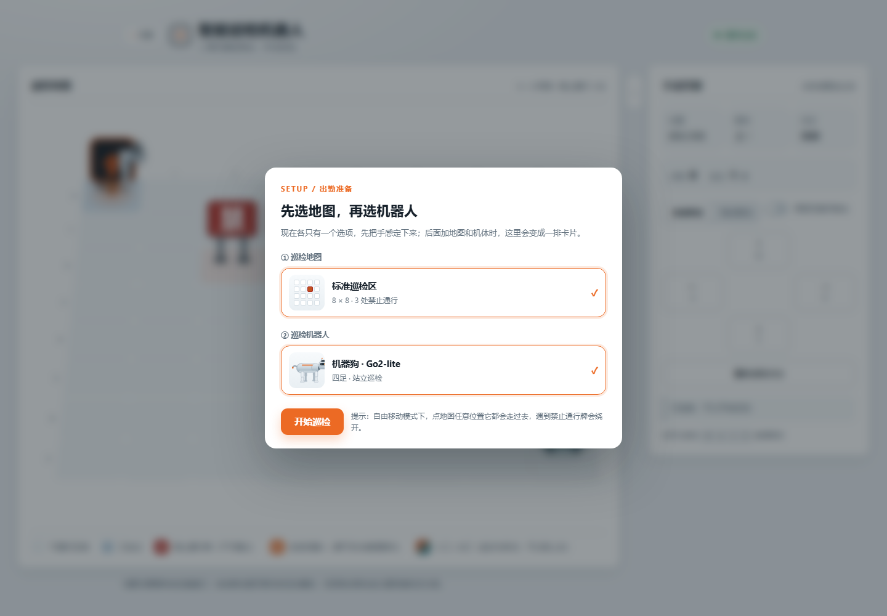
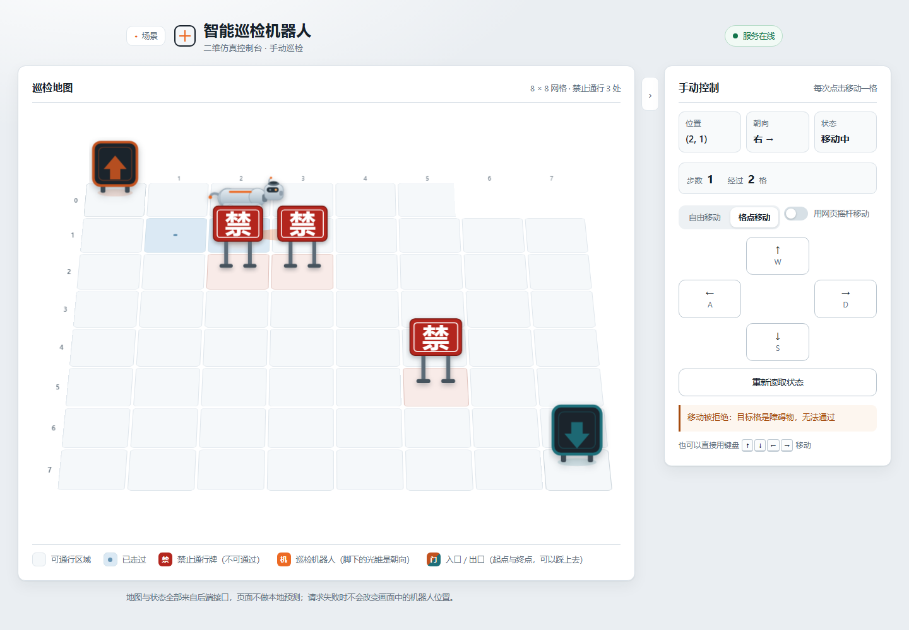

# 运行与结业提交

本文档记录本项目的实际运行方式与结业提交清单。提交前从干净的仓库副本按下面的步骤完整运行一次，并确认验收人员能访问仓库和成果材料。

## 本地运行

- 运行环境：Windows 11 + WSL2（Ubuntu 22.04 LTS）与原生 Windows 两套环境都实测通过；Python 3.10+（CI 在 3.14 上验证）、FastAPI + Uvicorn；浏览器为 Edge 或 Chrome 最新版。
- 一键启动：Linux / macOS / WSL 用 `./start.sh`，Windows 用 `start.bat`（或 `powershell -ExecutionPolicy Bypass -File start.ps1`）；脚本会自动建 `backend/.venv`、装依赖、挑一个没被占用的端口起服务并打开浏览器。
- 前后端启动顺序：先启动后端（`python3 -m app.main`，默认监听 8080），再由浏览器访问页面；前端不需要单独启动服务，`frontend/` 目录由后端在同一端口托管。
- 页面入口为 `http://localhost:8080/`，接口前缀为 `/api`：`/api/health` 健康检查、`/api/state` 查询状态、`/api/move` 移动。
- 启动后打开 `http://localhost:8080/`，先选地图与机器人，点「开始巡检」进入场景。预期表现：
  - 8×8 二维网格，3 处「禁止通行」牌，左上角入口、右下角出口，均可踩上去；
  - 机器人初始位于 (0, 0) 朝上；点地图、按 W/A/S/D 或推摇杆后移动，右侧面板同步更新坐标、朝向、状态与步数；
  - 撞到边界或牌子时页面提示失败、坐标不变；约 1 秒后状态自动从「移动中」回落「待命」。

### 界面截图

开场先选地图与机器人（当前各只有一项）：

进入场景后左侧是地图、右侧是控制面板，可以点地图、按 W/A/S/D 或开摇杆移动：

依赖安装、配置、启动命令和单端验证步骤分别见[前端 README](../frontend/README.md)与[后端 README](../backend/README.md)。

## Docker 部署

1. 在仓库根目录（即包含 `Dockerfile`、`backend/`、`frontend/` 的目录，可用 `ls Dockerfile` 确认）执行，所需 Docker 环境为 Docker Engine 24 及以上（本项目在 Docker Desktop + WSL2 下验证，镜像体积约 205MB）。

2. 无需额外配置文件，配置项只有环境变量 `PORT`：默认为 `8080`，示例 `PORT=8081`（改端口时 `docker run -p` 的宿主机端口需同步修改）。
3. 使用 `docker build -t patrol-sim:0.1 .` 构建镜像，再执行 `docker run -d --name patrol-sim -p 8080:8080 patrol-sim:0.1` 启动服务。
4. 打开 `http://localhost:8080/`，执行 `curl localhost:8080/api/health` 验证页面和 API，预期结果为接口返回 `{"status":"ok"}`，页面显示 8×8 二维地图与机器人，点击方向按钮后机器人移动一格、坐标同步更新。
5. 使用 `docker stop patrol-sim && docker rm patrol-sim` 停止服务。

容器以非 root 用户 `app`（UID 10001）运行，`PORT` 通过环境变量传入；`frontend/` 与 `backend/` 一并复制进镜像，一个容器同时提供页面和 API，构建时已排除 `.venv`、`tests` 与本地缓存目录。若构建环境访问 pypi.org 受限（出现 `CERTIFICATE_VERIFY_FAILED` 或 `Read timed out`），可在 `Dockerfile` 的 pip 命令中临时追加 `-i https://pypi.tuna.tsinghua.edu.cn/simple --trusted-host pypi.tuna.tsinghua.edu.cn` 后重新构建。

## 结业材料

| 材料 | 链接或仓库内路径 |
| --- | --- |
| 代码仓库或可访问的替代仓库 | https://github.com/LeeeweiH/patrol-sim |
| 项目 README | [根 README](../README.md) |
| 本地运行及 Docker 部署说明 | [运行与结业提交](04_运行与结业提交.md) |
| 项目架构图 | [项目架构与接口](03_项目架构与接口.md) |
| 可操作的在线演示（如已部署） | 未部署公网；本地运行 `./start.sh`（或 `start.bat`）后访问 <http://localhost:8080/> |
| 成果展示材料（截图、演示视频或其他展示资料） | 答辩现场演示；截图待补 |
| 个人完成内容或小组分工 | [小组分工](02_小组分工.md) |

## 展示安排

- 本项目未部署公网，根 README 的「在线演示」写的是本地运行方式；若后续部署，把实际地址补进去即可。
- 实际完成的版本和功能为 `v1.0.0`：8×8 地图与 3 处障碍、点击或长按地图的连续操控、连续扫掠碰撞避障与 A\* 绕障、入口/出口地标、网页摇杆、可折叠右栏、Docker 部署与 CI。
- 计划演示的操作及预期结果为：启动服务 → 打开页面 → 选场景并进入 → 点地图任意位置，机器人沿路径绕开禁止通行牌走过去 → 点「自动巡检」，机器人自动规划顺序走完整张地图并导出报告 → 撞边界时页面提示「已到地图边界」且坐标不变。
- 展示时要讲清主要功能、基本架构、运行方式和本人完成的开发内容。
